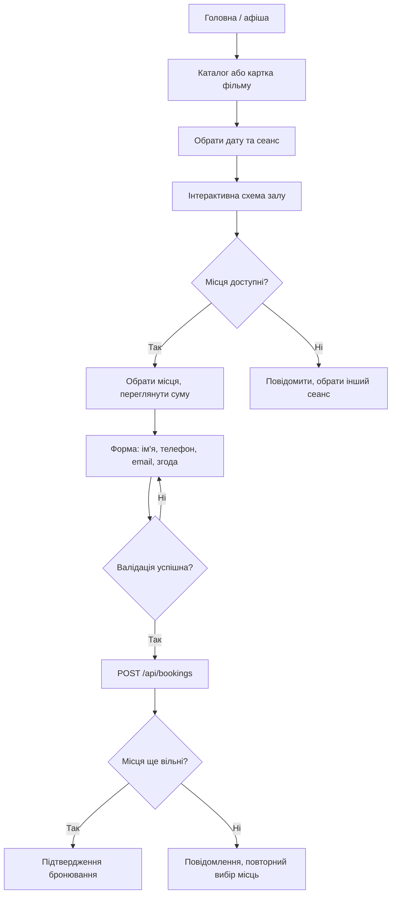

# UX-документація — Cinema-Ua

> Навчальний проєкт: сайт кінотеатру з вибором місць на інтерактивній схемі залу (варіант 14).
> Документ сформовано за ТЗ та інформацією README репозиторію. Коридорне тестування нижче є планом/модельованими результатами, а не підтвердженим дослідженням із реальними учасниками.


## 1. UX-мета

Допомогти відвідувачу швидко пройти шлях від пошуку фільму до бронювання квитків на одному сайті: афіша → фільм → сеанс → місця → дані покупця → підтвердження. Основні принципи: mobile-first, мінімум зайвих кроків, зрозуміла ціна, видимі статуси місць, доступність з клавіатури та можливість масштабування.

## 2. Персони

### Персона 1 — Марія, студентка, 20 років
- **Цілі:** швидко знайти фільм на сьогодні/вихідні, забронювати 2 місця поруч, бачити повну вартість.
- **Контекст:** користується смартфоном, часто переходить із соцмереж; може оформлювати бронювання дорогою.
- **Потреби:** швидкий пошук, фільтри, короткі картки фільмів, доступний розклад, touch-friendly схема залу.
- **Болі:** довгі форми, приховані ціни, перенаправлення на інший сайт, незрозуміло чи місце вже зайняте.
- **Критерій успіху:** забронювати два сусідні місця за кілька хвилин без допомоги.

### Персона 2 — Андрій, батько, 37 років
- **Цілі:** підібрати фільм для сім'ї, перевірити віковий рейтинг і тривалість, посадити сім'ю разом.
- **Контекст:** переглядає сайт із телефона або ноутбука, планує заздалегідь.
- **Потреби:** зрозуміла інформація про фільм, рейтинг, час, зал, ціна; вибір кількох місць поруч; читабельні елементи.
- **Болі:** неможливо знайти місця поруч, не видно обмежень за віком, дрібні елементи керування.
- **Критерій успіху:** обрати сеанс і потрібну кількість місць, зрозуміти підсумок до введення контактів.

## 3. User stories

1. **Як** відвідувач, **я хочу** переглядати афішу з назвою, постером, жанром, тривалістю та рейтингом, **щоб** швидко вирішити, який фільм дивитися.
2. **Як** користувач, **я хочу** шукати фільми та фільтрувати за жанром, датою й кінотеатром, **щоб** знайти відповідний сеанс.
3. **Як** покупець квитків, **я хочу** бачити схему залу зі статусами місць і вибирати/скасовувати місця, **щоб** бронювати саме ті місця, які мені потрібні.
4. **Як** користувач, **я хочу** бачити кількість квитків і загальну суму, яка оновлюється при виборі місць, **щоб** до оформлення знати вартість.
5. **Як** покупець, **я хочу** заповнити форму бронювання з перевіркою даних та отримати підтвердження, **щоб** мати деталі свого замовлення.

## 4. User flow



### Альтернативні гілки
- Якщо фільтр не повернув результатів — показати empty state, кнопку очищення фільтрів.
- Якщо місце зайняте — не дозволяти вибір і пояснити статус.
- Якщо API недоступний — показати помилку та дію «Спробувати ще раз».
- Якщо користувач змінює сеанс — скинути попередній вибір місць.
- Якщо форма невалідна — показати помилки біля полів і не відправляти запит.
## 5. Wireframe: опис екранів

### Екран 1 — Головна / афіша
- Верхня панель: логотип Cinema-Ua, навігація, перемикач теми.
- Основний заголовок і найближчі фільми/сеанси.
- Картки фільмів: постер, назва, жанр, тривалість, рейтинг, CTA «Сеанси».
- Мобільно: вертикальна стрічка карток, навігація компактна.

### Екран 2 — Каталог
- Заголовок «Фільми».
- Поле пошуку з debounce 300 ms.
- Фільтри: жанр, дата, кінотеатр; кнопка скидання.
- Сітка/список карток, стани loading/error/empty.

### Екран 3 — Фільм і сеанси
- Постер, назва, опис, трейлер, тривалість, віковий рейтинг.
- Список сеансів із датою/часом, залом і ціною.
- CTA для переходу до вибору місць.

### Екран 4 — Схема залу
- Заголовок із назвою фільму, сеансом, залом.
- Позначення екрана/напрямку перегляду.
- Сітка місць: 7 рядів × 11 місць; 7-й ряд VIP.
- Легенда статусів: вільне, зайняте, обране, VIP.
- Підсумок вибраних місць і сума (звичайне 220 грн, VIP 550 грн), CTA «Продовжити».
- Місця мають доступні назви (наприклад, «Ряд 5, місце 7, вільне»), клавіатурний фокус, мінімальна touch target 44×44 px за ТЗ.

### Екран 5 — Бронювання
- Список фільму, сеансу, залу, вибраних місць і суми.
- Поля: ім'я, телефон, email, коментар (необов'язковий), checkbox згоди.
- Помилки валідації біля відповідних полів; CTA неактивний, якщо форма невалідна.

### Екран 6 — Підтвердження
- Повідомлення про успішне бронювання.
- Номер бронювання, фільм, сеанс, зал, місця, сума.
- Кнопка повернення до афіші.
## 6. Закони Фіттса та Хіка

### Закон Фіттса
Час досягнення цілі залежить від відстані до неї та розміру цілі: чим ближче і більша кнопка, тим легше натиснути.
- Основні CTA («Обрати сеанс», «Продовжити», «Забронювати») мають достатній розмір і помітну область натискання.
- На схемі залу цілі мають бути не менше 44×44 px на мобільних пристроях (вимога ТЗ).
- Кнопки «вибрати»/«скасувати» мають бути розташовані близько до контексту, а не в іншій частині сторінки.
- Відстань між інтерактивними місцями слід оптимізувати, щоб зменшити випадкові натискання.

### Закон Хіка
Час прийняття рішення збільшується зі складністю та кількістю доступних варіантів.
- Не показувати всі фільтри одразу на мобільному; групувати за жанром і датою.
- На картці фільму залишати ключові характеристики, а подробиці показувати на сторінці фільму.
- Сеанси групувати за датою, а не виводити нескінченний список.
- Схему залу доповнювати легендою, підсумком і чітким станом кожного місця.
- Відображати обмеження вибору (максимум 8 місць) до того, як користувач досягне ліміту.
## 7. Дизайн-система

### Палітра (запропоновані токени; перед використанням перевірити contrast checker)
| Token | Значення | Призначення |
|---|---|---|
| `--color-bg` | `#0B0B0F` | Основний темний фон |
| `--color-surface` | `#17171F` | Картки/поверхні |
| `--color-surface-alt` | `#23232D` | Вторинні поверхні |
| `--color-text` | `#F5F5F7` | Основний текст |
| `--color-text-muted` | `#B8B8C4` | Другорядний текст |
| `--color-primary` | `#E50914` | CTA/акцент бренду |
| `--color-primary-hover` | `#B80710` | Hover/pressed акцент |
| `--color-success` | `#36B37E` | Вільне/успішне (додатково іконка/текст) |
| `--color-warning` | `#F5A623` | Попередження |
| `--color-danger` | `#D64545` | Помилка/зайняте (не лише кольором) |
| `--color-focus` | `#77B7FF` | Видимий keyboard focus |

Контраст тексту з фоном має бути ≥4.5:1 для звичайного тексту (WCAG AA). Статуси місць не передавати лише кольором — додавати текст, піктограму, штрихування/форму. Точні контрастні пари палітри необхідно прогнати через WCAG contrast checker; токени вище є стартовою пропозицією, а не сертифікованим вимірюванням.

### Типографіка
- **Unbounded** — заголовки, назви секцій, акцентні заголовки.
- **Inter** — основний текст, UI, кнопки, форми, повідомлення.
- Заголовки мають чітку ієрархію; довгі тексти не набирати Unbounded.

### Токени
```css
:root {
  --font-heading: 'Unbounded', sans-serif;
  --font-body: 'Inter', sans-serif;
  --space-1: 4px; --space-2: 8px; --space-3: 12px;
  --space-4: 16px; --space-5: 24px; --space-6: 32px;
  --radius-sm: 6px; --radius-md: 12px; --radius-lg: 20px;
  --shadow-card: 0 8px 24px rgba(0,0,0,.18);
  --transition-fast: 150ms ease;
  --content-max: 1200px;
}
```
### Компоненти
- `Header` / `Navigation` / `ThemeToggle`
- `MovieCard` / `MoviePoster` / `MovieMeta`
- `SearchInput` / `FilterSelect` / `FilterChips`
- `SessionCard` / `SessionTimeButton`
- `Seat` / `SeatMap` / `SeatLegend` / `BookingSummary`
- `FormField` / `Checkbox` / `Button`
- `Alert` / `Toast` / `LoadingSkeleton` / `EmptyState`
- `Footer` / `SkipLink`
### Стани компонентів
Кожен інтерактивний компонент має default, hover, focus-visible, active, disabled та error (де застосовно). Мобільні стани не залежать від hover.
## 8. Коридорне тестування

**Статус:** сценарій та таблиця нижче — модельований приклад для документації. Не є доказом тестування реальних людей. Щоб перетворити на фактичні результати, провести тест із 3–5 учасниками й замінити записи їхніми спостереженнями.


### Завдання учасникам
1. Знайти фільм і сеанс на сьогодні.
2. Обрати два сусідні вільні місця.
3. Перевірити суму та перейти до форми.
4. Заповнити форму й знайти підтвердження.

### Модельовані зауваження та виправлення
| Зауваження | Запропоноване виправлення | Пріоритет |
|---|---|---|
| Не одразу помітно, де змінити дату | Винести дату над списком сеансів, додати чіткий label | High |
| Легенда статусів місць не очевидна | Показати легенду перед схемою та текстові статуси | High |
| На телефоні складно натиснути маленьке місце | Збільшити hit-area до 44×44 px, не лише видиму іконку | High |
| Неясно, чи вибір місця скасовується повторним натисканням | Пояснити поведінку та показувати стан «Обране» | Medium |
| Підсумок замовлення не видно після прокручування | На mobile закріпити компактний summary/CTA (перевірити, щоб не перекривав контент) | Medium |
| Помилки форми з'являються без пояснення | Додати текст помилки поруч, aria-describedby, фокус на першій помилці | High |

## 9. AI-промпти для мудборду

### Prompt 1 — загальний moodboard
> Create a visual moodboard for Cinema-Ua, a modern Ukrainian cinema booking website. Dark cinematic atmosphere, deep charcoal background, vivid red accents, soft film-grain texture, glowing marquee inspiration, contemporary editorial layout, premium but approachable, mobile-first UI. Avoid clutter, ensure high contrast and accessible UI. Include visual inspiration for movie cards, seat map, buttons, typography. Do not create a finished website screenshot; create a design direction board.


### Prompt 2 — UI/UX direction
> Design direction board for a mobile-first cinema ticket booking interface. Visual hierarchy: movie poster, session time, seat selection map, booking total. Use charcoal surfaces, red primary CTA, white text, muted gray secondary text, subtle rounded corners. Typography pairing: Unbounded for headings and Inter for UI/body. Show examples of empty, selected, occupied and VIP seat states with patterns or labels, not color alone.

### Prompt 3 — assets / poster treatment
> Cinema campaign art direction board: contemporary film festival mood, dramatic lighting, abstract light beams, black and crimson palette, high contrast, texture of film, restrained composition, premium cinema identity. No logos or copyrighted movie characters, no legible fake text.
## 10. UX acceptance criteria
- Основний booking flow проходиться без переходу на сторонній домен.
- На mobile ширина 360 px не спричиняє горизонтального скролу сторінки (схема місць може мати окреме кероване прокручування, якщо потрібно).
- Місця мають текстові доступні назви, фокус і керування клавіатурою.
- Обрані місця, кількість і сума оновлюються синхронно.
- Користувач розуміє причину помилки та спосіб її виправити.
- Масштаб браузера не заблокований.
